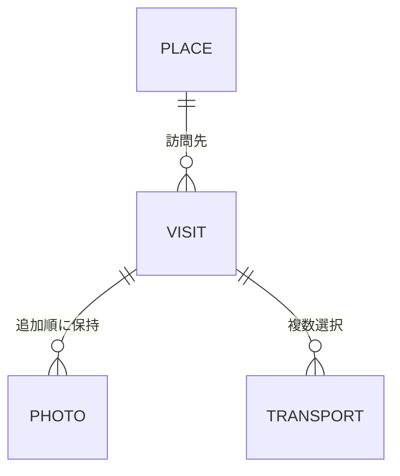

# 端末内データの設計案

## 状態と目的

この文書は、確定した[訪問記録のルール](record-model.md)を実現するための技術設計案。場所・訪問状態・訪問記録・写真・交通手段・表示設定に分ける基本構造は確認済み。具体的な列・制約・DDLは設計案で、まだ実装していない。

目的は、少ない依存で端末内に記録を保存し、写真の追加削除でも端末内の思い出とアルバムの配置を維持すること。

## データの関係

| データ         | 保持する内容の案                                                             | 要件との関係                                                               |
| -------------- | ---------------------------------------------------------------------------- | -------------------------------------------------------------------------- |
| 場所の定義     | 安定した識別子、都道府県・国の区分、日本語名、地図形状への対応               | 同梱する固定データ。表示名や配列順を識別子に使わない                       |
| 場所の訪問状態 | 場所の識別子、行ったかどうか                                                 | 訪問記録がなくてもピンを留められる                                         |
| 訪問記録       | 安定した識別子、場所の識別子、開始日、終了日、日記、作成日時、更新日時       | タイトルや旅行全体の単位は設けない。作成日時は同日開始の履歴の並び順に使う |
| 写真           | 安定した識別子、訪問記録の識別子、ファイルの相対パス、寸法、追加順、配置情報 | 画像本体はファイルに分離し、DBに画像データを埋め込まない                   |
| 交通手段       | 訪問記録の識別子、手段の識別子、「その他」の文章                             | 複数選択を保持する。定義済みの手段は同梱データ                             |
| 表示設定       | 前回開いた日本地図・世界地図、チュートリアルの表示状態                       | 地図の種類の記憶と初回案内を実現する                                       |

地図の拡大率・表示位置は、アプリ使用中に各地図について保持し、次回起動用には永続化しない。アプリを終了して新たに起動した場合は、前回選んだ日本・世界の地図を全体表示する。初回起動は日本地図とする。

## DBの構造（基本構造は確認済み、列・制約は設計案）

SQLiteの通常のテーブルとSQLで管理する。ORMや旅行全体のテーブルは追加しない。

| テーブル         | 主な列の案                                                                                       | 役割・制約                                                                                                                |
| ---------------- | ------------------------------------------------------------------------------------------------ | ------------------------------------------------------------------------------------------------------------------------- |
| places           | id、kind、name_ja                                                                                | 同梱データから用意する場所マスター。kindは都道府県・国。idは名称や地図の形状から独立した固定文字列                        |
| place_states     | place_id、visited                                                                                | 場所ごとに一つの訪問状態。記録がなくても訪問済みにできる。未作成の状態は未訪問として扱う                                  |
| visits           | id、place_id、start_date、end_date、diary、created_at、updated_at                                | 一回の連続した訪問。日帰りも開始日と終了日を同日に揃え、開始日のみの特殊な保存形式を作らない。場所は作成後に変更しない    |
| photos           | id、visit_id、image_path、thumbnail_path、width、height、sort_order、layout_version、layout_data | 写真本体とサムネイルはファイル。順序・縦横比・スクラップ配置に必要な情報を保持。layout_dataの具体形式は配置設計後に定める |
| visit_transports | visit_id、transport_code、other_text                                                             | 交通手段の複数選択。訪問と交通手段コードの組み合わせは一つ。同じ手段の重複は保存しない                                    |
| app_settings     | key、value                                                                                       | 前回の日本・世界の選択やチュートリアル表示状態。画面の一時的な拡大率・表示位置は保存しない                                |

### 場所の識別と地図との分離

- 記録可能な場所は都道府県47と日本以外の国194。世界地図の日本は地図側の案内先として扱い、独立した訪問状態・訪問記録を保存しない。
- placesの固定IDと表示用の地図形状を対応付ける。地図データの配列順・座標・表示名を記録の識別子に使わない。
- visits・photosには変更しない文字列IDを付ける。具体的な生成方式は初期構築前に定め、ID生成のためだけにライブラリを追加する前に既存構成で満たせるか確認する。

### 値と整合性の扱い

- 訪問日は暦日の文字列YYYY-MM-DDとして保存する。作成日時・更新日時は並び順と管理用の時刻として別に保持し、訪問日の時差換算に使わない。
- placesからvisits・place_states、visitsからphotos・visit_transportsへの参照を維持する。SQLによる更新はパラメーターを渡して行う。
- 開始日・終了日は必須で、終了日は開始日以降とする。未来日の検証は保存処理で行う。同じ場所・同じ期間の重複を禁止する制約は設けない。
- 写真の順序は訪問内で管理し、読み出し時に明示的に指定する。削除しても写真のID・傾き等を再生成しない。
- 訪問の一覧にはplace_id・start_date・created_at、写真の一覧にはvisit_id・sort_orderを使う想定で索引を設計する。最終的なDDL・索引・同値時の並び順は別途具体化する。
- DB上の関連削除と画像の実ファイル削除を区別する。DBの参照整合性だけでファイルの削除まで完了したとは扱わず、後述の保存・削除手順に従う。

## 場所と訪問状態

- 国内の訪問記録は都道府県に、海外の訪問記録は日本以外の国に紐づける。
- 世界地図の日本は、都道府県の訪問状態から算出する。日本全体の訪問記録や独立した訪問状態を二重管理しない。
- 訪問記録を保存すると、その場所を「行った」にする。同じDB更新のまとまりとして扱う案。
- 訪問記録の個別削除では、その場所の訪問状態を変更しない。別の場所への記録の移動は設けない。
- 場所を「行っていない」に戻す操作は、確認後にその場所の訪問記録と写真情報も削除する。

## 日付

- 日付は時刻・タイムゾーンを含まない暦日として扱う。
- 保存時は、日帰りでも終了日を開始日と同日に揃える案。入力画面では一度だけ日付を選ぶ。
- 開始日・終了日の前後関係と未来日を保存前に検証する。
- 履歴は開始年で区切り、開始日の降順で並べる。同日開始の記録は作成日時の降順とし、開始日を変えない編集では順番を変えない。作成日時は更新日時と分けて保持する。作成日時も同一の場合の最終的な並び順は実装設計で定める。

## 写真とスクラップの配置

- 横長は大きめ・縦長は小さめを目安に、幅・位置・傾き・余白を写真ごとに変化させる。全体は2列程度に収め、向きの組み合わせによる固定比率や、繰り返しが分かる見た目を避ける。毎回自由な乱数で再配置する方式にはしない。
- 写真の追加順と描画上の位置を分けて保持する。写真番号・全画面表示は追加順とし、配置は重なりと不自然な空白を避けるように調整する。変化の範囲・編集時の局所的な幅調整・余白の許容範囲は具体案で確認する。
- 写真ごとに安定した識別子を持たせ、ファイル名・追加順と切り離す。削除後に残った写真の識別子を付け直さない。
- 写真本体はアプリの永続領域に保存し、DBにはその領域からの相対パスを記録する案。DBの参照は永続領域を基準に解決する。
- 端末内には表示用に縮小した写真を保存する。長辺最大3,072pxを仮の基準とし、小さい写真は引き伸ばさない。実装時に画質と容量を確認する。元画像を保存したり復元したりする機能は設けない。
- 写真の保存形式はJPEGとし、透明部分がある画像は白背景にする。具体的な変換方法・圧縮品質は実装時に検証する。
- サムネイルは再生成可能な派生データとして扱う案。先頭の写真が削除されたら、残った先頭写真を使う。
- 写真の傾き・サイズ区分・配置グループなど、再表示に必要な情報を保持する案。毎回の乱数や写真の配列位置だけに依存しない。
- 写真を追加した際は既存写真の配置情報を維持して新しい分を加える。削除時は残った写真を全体で再抽選せず、順序どおり前に詰めて大きな空白を残さない。そのための位置移動は許容し、大きさ・傾きはできるだけ維持する。
- 別端末などで画面幅が変わった場合は、写真の順序・傾き・大小の特徴を引き継ぎ、位置・余白を画面幅に合わせて調整する。絶対座標や表示寸法の完全一致は要件にしない。具体的な計算方法と文字サイズ変更への対応は未確定。
- 将来配置方式を変更する場合に備え、配置情報の形式を識別するバージョンを持たせる案。

## 入力・保存・削除

1. 編集画面では、保存済みデータとは別の作業中の状態を持つ。
2. 新たに選んだ写真は作業用領域へ取り込み、失敗した分を通知する。既存写真の削除は、この段階で実ファイルを消さない。
3. 保存時に入力を検証し、新しい写真ファイルを永続領域へ配置する。
4. 写真情報・訪問記録・訪問状態のDB更新を、まとまりとして確定する。
5. 成功後に不要になったファイルを削除する。

DBと写真ファイルは別の保存先なので、一つのDBトランザクションだけで全処理が原子的になるとは考えない。途中終了時に保存済み記録が参照する画像を消さない順番にする。失敗時の後片付けは再実行できるよう設計し、一時ファイルの清掃と保存済み画像の削除を区別する。

編集を取り消した場合は、追加途中の一時ファイルを破棄して保存済みの状態を保つ。アプリ終了後の下書き復元は行わない。

## バックアップと復元（MVP対象外）

機種変更時の引き継ぎを含め将来候補へ移した。以前の設計は[保留資料](future-backup.md)を参照。MVPでは端末内の記録・写真を失わない保存・更新・削除に集中し、バックアップ形式や移行互換のための先行実装はしない。

## 設計上の残件

1. DBスキーマ、更新時の移行と復旧の具体化。
2. 写真の長辺最大3,072pxという仮基準の検証、JPEGの圧縮率・透明部分の白背景への変換・サムネイルの基準。
3. 写真配置の生成、追加削除、異なる端末幅への対応。

いずれも、機能追加ではなく既存の記録・振り返り要件を満たすための残件として扱う。
