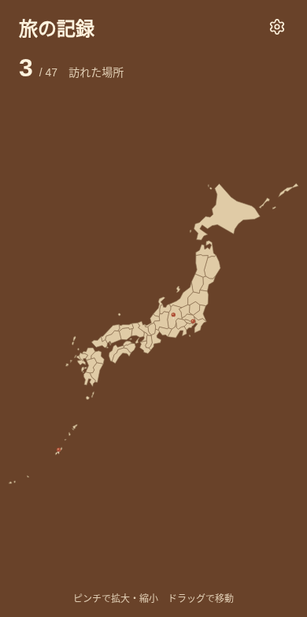
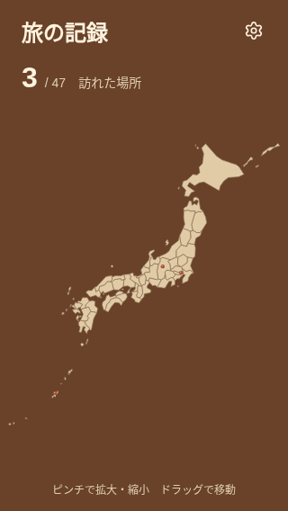
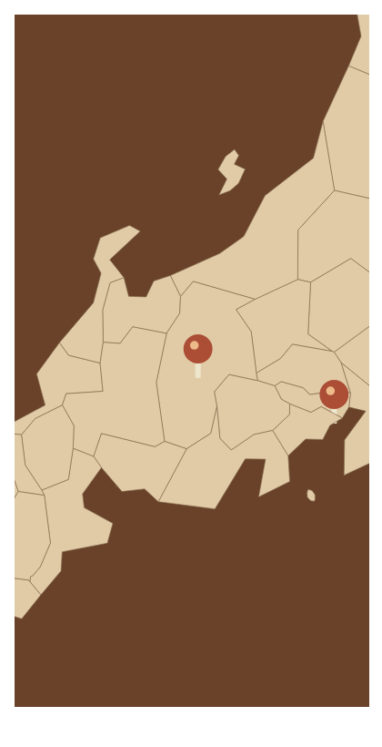

# アナログ地図ボードの再レビュー

2026-11-07。粗い木製パーツの雰囲気と、県を選んで記録する操作を両立するため、全体表示・最大拡大・小さい画面・地理的な省略を見直した。スクリーンショットは製品と同じ `MapBoard` / `JapanMap` をブラウザStorybookで表示したもの。ブラウザ向けの製品保存機能は追加していない。

## 見つかった問題と修正

| 観点         | 問題                                                                               | 修正と再確認                                                                                                                          |
| ------------ | ---------------------------------------------------------------------------------- | ------------------------------------------------------------------------------------------------------------------------------------- |
| 省略の強さ   | 一律に強く簡略化すると、主要な島まで消え、沖縄・鹿児島・長崎の形が小さくなりすぎる | 元の面積で微小な島だけを整理し、主要な島を個別に保護。沖縄の4島、屋久・種子・奄美、対馬・壱岐・福江などの内陸代表点を検査             |
| 特徴的な輪郭 | 能登・下北などの特徴まで単純な塊になる                                             | 小さなパーツと特徴的な半島だけ簡略化を弱め、大部分の県境は大きな辺のまま維持                                                          |
| 地理的な改変 | 点数だけを減らしても、形の大きな変化を検出できない                                 | 表示対象の元の陸地面積から80〜120%を外れる県は生成を拒否。現在は約84〜110%の範囲。県や島の並べ替え・単独拡大・別枠への移動はしない    |
| 全体表示     | 固定の表示枠に余計な余白が残り、地図が上に寄る。端の島が切れる可能性もある         | 全輪郭の外接範囲と16単位の余白から表示枠を生成。320px幅でも全パーツが収まり、輪郭全体の中心と表示中心のずれが2px以内であることを確認  |
| 指操作       | 全体表示で動く、縮小中にはみ出す、指を離しても滑る動作は不要                       | 等倍固定、表示範囲内への制限、慣性・跳ね返りなしを維持。47県の選択と最大6倍を再確認                                                   |
| 境界・色     | 木の色が強すぎると、境界や文字が埋もれる                                           | 生成りの地形・中間色の細い県境・明るい文字を維持。SVG内部で拡大し、境界の太さを一定にする。木目模様や地名は出さない                   |
| 画面の状態   | 地図だけの表示例では、ヘッダーや通知で狭くなる実画面を確認できない                 | 製品の画面部品をStorybookでも共有。通常・未訪問・全県訪問済み・読み込み中・読み込みエラーを確認。正常時は再読み込みボタンを表示しない |

900頂点・85リングへ整理した地図は約18KB。元の細かな輪郭へ戻すのではなく、主要な島と認識に必要な特徴へ点数を割り当てた。固定IDと保存済み記録の関係は変更していない。

## 表示の記録

390 × 784の画面内容。上部の訪問数・設定、中央の地図、下部の操作案内を製品と同じ配置で確認した。

320 × 568でも、設定の44pxタップ領域と操作案内が収まり、全体表示の島が切れない。

最大6倍では、県境が太くならず、丸い接合のベクターとして表示される。

## 検証の範囲

- `pnpm check`：20ファイル・200テスト。主要な島・半島の代表点、ピンの内包、隣県の共有境界、表示枠への収まり、非ゼロ原点の拡大基準を含む。
- `pnpm build-storybook`：成功。
- Playwright / Chromium：地図上の座標から47県すべてを選択。最大6倍、縮小下限、全体表示中の移動固定、パン後の静止、余白内への収まりを確認。
- 実画面のStorybook：通常・320px幅・未訪問・全県訪問済み・読み込み中・エラーの6状態。正常時の不要なボタン、画面外へのはみ出し、実行時例外がないことを確認。
- 文字の配色は、本文／背景・補足／背景・主要ボタン文字／背景・地図上の文字／ボードで5:1以上の明暗差を維持。全県にピンを置いても、現行の半径4の頭どうしが重ならない配置を確認した。

ブラウザでの表示・タッチ操作と、ネイティブ実機での操作感は区別する。iPhone実機でのピンチ、読み上げ、大きい文字サイズ、写真を伴う保存の受け入れ確認は未実施。CIの最新結果はPRのチェック欄を参照する。レビューとマージは人が担当する。
