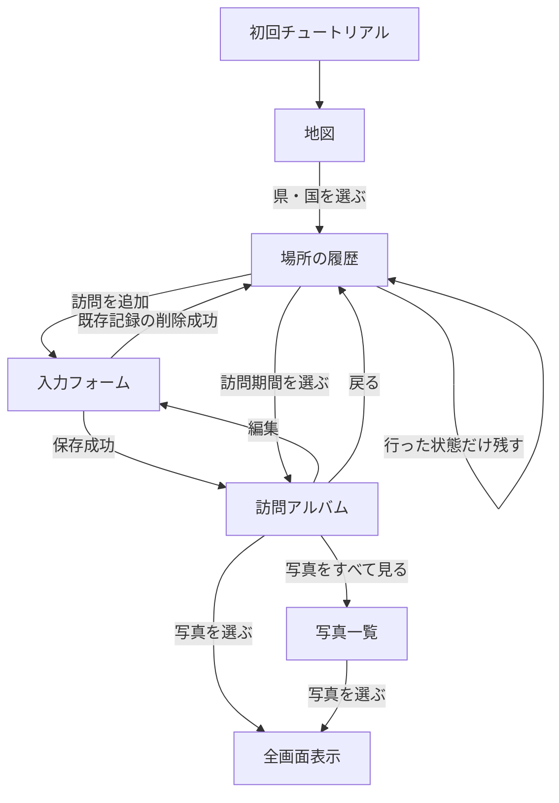

# 地図と振り返りの体験

## 体験の中心

多機能化より、木製ボードにピンを留め、紙のアルバムで思い出を振り返る体験を優先する。写真の位置や傾きを自分で調整しなくても、記録を追加するだけでアナログらしい見た目に仕上がる。

[採用したスクラップ風のHTMLモック](mockups/index.html)で、主要画面の見た目と操作の流れを確認できる。[モックの説明](mockups/README.md)を参照。具体的な配置・色・素材は調整対象とする。

## 主要画面と役割

| 画面               | 役割と主な操作                                                   | 表現                                                     |
| ------------------ | ---------------------------------------------------------------- | -------------------------------------------------------- |
| 地図               | 日本・世界を切り替え、県・国を選ぶ。拡大して場所を探す           | 濃い木製ボード、薄い茶色の地形、実物風の画鋲             |
| 場所の履歴         | 訪問状態の切り替え、年別の履歴、訪問の追加                       | 紙の雰囲気。期間と小さなサムネイルで訪問を見分ける       |
| 訪問アルバム       | 場所・期間・交通手段、写真プレビュー、日記を読む。編集へ進む     | 紙の台紙、マスキングテープ、少し傾いた写真。縦スクロール |
| 訪問の入力・編集   | 日付、写真、日記、交通手段を入力し、保存する。既存記録を削除する | 紙の雰囲気を残したフォーム                               |
| 写真一覧           | 一件の訪問の全写真を追加順に見る                                 | 台紙とテープ。元の縦横比を保ち、写真は重ねない           |
| 写真の全画面表示   | 写真を拡大し、左右スワイプで同じ訪問の写真を切り替える           | 写真全体を見られる表示                                   |
| 設定               | 説明、チュートリアルの再表示                                     | 具体的なレイアウトは未決定                               |
| 初回チュートリアル | ピン、訪問記録、端末内保存を案内。スキップ可能                   | 具体的なレイアウトは未決定                               |

## 基本の操作の流れ

### 記録する

1. 地図で場所を選ぶ。
2. ピンだけ残す場合は「行った」に切り替えて終了する。
3. 思い出を残す場合は「訪問を追加」し、必須の日付を入力する。写真・日記・交通手段は任意。
4. 保存すると場所の履歴に一件追加され、ピンも付く。保存した記録のアルバムを表示する。

### 振り返る

1. 地図から場所の履歴を開く。
2. 年と期間、サムネイルを手掛かりに一件の訪問を選ぶ。
3. アルバムで写真と日記を見る。写真が多い場合だけ写真一覧へ進む。
4. 地図へ戻ると、元の表示位置と拡大率が保たれる。

詳細な保存・削除ルールは[訪問記録モデル](record-model.md)、機能の範囲は[MVPの範囲](mvp-scope.md)を参照。バックアップと引き継ぎはMVPに含めない。

## 決定事項

- 振り返りの主な入口は地図。場所を選んで訪問履歴を見る。
- 地図のピンは、場所ごとの「行った／行っていない」の状態で決める。訪問記録がなくてもピンを表示できる。
- 訪問記録を追加すると、その場所は自動で「行った」になる。記録を削除しても「行った」は維持する。
- ピンを外して「行っていない」に戻すとき、訪問記録があれば削除件数と写真枚数を示して確認する。確定すると、その場所の訪問記録と紐づく写真なども削除する。
- ピンのない県・国も地図上で選べる。選んだ場所で「行った」に切り替える操作を主にする。
- 日本地図と世界地図は、別の地図として切り替える。
- アプリの初回起動時は日本地図を表示する。
- 2回目以降の起動では、前回見ていた日本地図または世界地図を表示する。
- 初回起動時には、初めて使う人向けのチュートリアルを表示する。端末内保存であることも案内する。
- チュートリアルは途中でスキップできる。使い方と端末内保存の説明は設定画面にも残す。
- 設定画面からチュートリアルを再表示できる。
- 初回チュートリアルでは、地図から場所を選んでピンを留めること、訪問日・写真・日記を記録して見返すこと、記録が端末内に保存されることを説明する。バックアップの案内は外す。従来の3画面構成は見直し、画面数・具体的な説明文は未決定とする。
- 世界地図は木製ボード上の平面地図として表示する。回転する地球儀はMVPに含めない。
- 日本地図と世界地図は、指で拡大縮小・移動できる。
- 全体表示に戻す専用ボタンは設けず、指の縮小操作で戻す。
- アプリを使用している間は、日本地図と世界地図それぞれの拡大率・表示位置を保ち、切り替えて戻ったときにも復元する。
- アプリを終了して新たに起動した場合は、前回選んだ日本・世界の地図を全体表示する。拡大率・表示位置は次回起動へ引き継がない。初回起動は日本地図を表示する。
- 場所の画面から地図へ戻るときは、開く前の拡大率と表示位置を保つ。
- 訪問済みの場所は、ピンと県・国の形のどちらをタップしても選べる。
- 同じ県・国へ複数回訪問しても、地図上のピンは場所ごとに一つだけ表示する。回数や日付は場所の訪問履歴で確認する。
- 世界地図では、訪問済みの都道府県が1つ以上あれば日本にピンを表示する。日本の訪問状態を別途入力する必要はない。
- 世界地図で日本を選ぶと、日本地図へ移る。
- 県・海外の国を選んだ直後は、その場所への訪問日・期間の一覧を表示する。訪問を選ぶと、その訪問の写真・日記・交通手段を見られる。
- 新しい訪問記録は、地図上で県・国を選び、その場所から「訪問を追加」して作る。
- 場所の訪問履歴は「2026年」「2025年」のように年ごとに区切り、年も訪問記録も新しい順に表示する。
- 年をまたぐ訪問記録は開始日の年に一件だけ表示し、訪問期間は年をまたぐことが分かる形で表示する。
- 訪問履歴の並び順は訪問開始日の降順とする。
- 訪問開始日が同じ場合は作成日時の降順とし、後から作成した記録を上に表示する。開始日を変えない編集では並び順を変えない。
- 訪問履歴一覧には、各訪問の日付・期間と写真サムネイルを1枚表示する。写真がない訪問は日付・期間だけを表示する。
- 訪問履歴一覧の小さなサムネイルは同じ形に切り取って表示する。訪問記録の写真プレビュー・写真一覧・全画面表示では写真全体を表示する。
- 訪問記録内の写真をタップすると、画面いっぱいに拡大して見られる。
- 訪問記録の詳細画面は、上部に場所と訪問期間を表示し、写真、日記の順に並べる。
- 入力された交通手段は、詳細画面上部の訪問期間の近くに表示する。
- 交通手段は小さなイラストと名称の文字を組み合わせ、アルバムにスタンプを添えた雰囲気で表示する。イラストだけで意味を伝えない。
- 訪問記録の閲覧画面では入力済みの項目だけを表示し、日記・交通手段などの未入力表示は出さない。
- 日記は折りたたまず全文を表示し、縦スクロールで読む。「続きを読む」の操作は設けない。
- 訪問記録の詳細画面では追加順で先頭2枚までの写真をプレビューする。写真が3枚以上ある場合は「写真をすべて見る（○枚）」を表示し、その訪問の写真一覧を開く。○枚はプレビューを含む写真の総数とする。写真が1〜2枚の場合は全枚をプレビューし、このリンクは表示しない。写真がない場合は写真領域を表示しない。
- 全画面で開いた写真は、指の操作でさらに拡大して細部を見られる。
- 全画面表示中は、左右スワイプで同じ訪問記録の前後の写真へ移れる。
- 写真の追加・削除は記録の入力・編集画面にまとめる。アルバム・写真一覧・全画面表示は閲覧用とし、写真の削除操作を置かない。
- サムネイルには、その訪問記録で最初に追加した写真を自動で使う。代表写真を別途選ぶ操作はMVPでは設けない。
- サムネイルに使っていた写真を削除した場合は、残っている写真の先頭を自動で使う。写真がなくなればサムネイルを表示しない。
- 県・国は地図上で選択する。検索フォームと補助の場所一覧は設けない。小さな場所は地図を拡大して選ぶ。
- 県・国を選んだ後の同じ画面に、「行った／行っていない」の切り替え、訪問履歴一覧、「訪問を追加」をまとめる。
- 県・国を選ぶと、地図に重なるパネルではなく、独立した場所の画面を開く。戻る操作で地図へ戻る。

## 見た目の方向性

- HTMLデザイン案「04 休日のスクラップ」を全画面のデザインのベースとして採用する。地図・履歴・アルバム・入力編集・写真一覧・設定で、木・紙・テープの雰囲気を統一する。モック内の具体的な色・余白・配置をそのまま確定するものではない。
- 訪問記録の詳細画面は、写真を台紙に貼って日記を綴る「紙の旅行アルバム」として表現する。地図の木製ボードから、訪問ごとのアルバムを開く体験とする。
- アルバムの写真は、紙の台紙にマスキングテープで貼ったように表現する。横長は大きめ・縦長は小さめを目安に、幅・位置・傾き・余白に写真ごとの変化を付け、手で貼ったように見せる。
- 全体は2列程度に収める。向きの組み合わせで2：1・1：1などの比率を固定せず、左右の固定列や繰り返しのパターンが目立たない見た目にする。具体的な変化の範囲と配置アルゴリズムは未決定。
- 上記の自然なスクラップ配置を基本方針として確認済み。HTMLモックの具体的な数値・配置計算をそのまま本実装の確定仕様とはせず、実機と写真数を増やした状態で具体化する。
- [写真一覧モック](mockups/photos.html)で具体案を提示する。元の縦横比を保ち、隣の写真の高さに合わせて生じる大きな空白を避ける。写真番号・全画面表示の順序は追加順にする。可変幅・順序・重なり防止を両立した際の余白の許容範囲は、モックを確認して決める。
- 写真は少し傾けて手作り感を出すが、写真同士は重ねず、内容を隠さない。
- 写真の位置と傾きはアプリが自動で決める。利用者が位置・傾きを調整する機能はMVPに設けない。
- 同じ訪問記録を開き直しても、写真の大きさ・位置・傾きは変わらない。ランダムに見える変化を付ける場合も、閲覧のたびに再抽選しない。具体的な生成方法は技術設計で決める。
- 上記の配置維持は同じ画面幅での再表示を前提とする。機種変更などで画面幅が変わった場合は、写真の順序・傾き・大小の特徴を引き継ぎ、位置・余白を画面幅に合わせて調整する。絶対座標や写真の表示寸法を端末間で完全一致させることは要件にしない。
- 写真を追加・削除した場合も、既存写真の大きさ・位置・傾きをできるだけ保ち、全体を配置し直すことは避ける。削除後は残った写真を順序どおり前に詰め、大きな空白を残さない。このため位置の移動は許容し、大きさ・傾きはできるだけ維持する。重なりを防ぐ具体的な調整方法は配置方式の設計で定める。
- 日記には読みやすい通常の書体を使う。手書き風の書体は使わず、紙・写真・テープの表現でアルバムらしさを出す。
- MVPではアルバムの紙・テープのデザインを共通の一種類に統一する。訪問ごとのテーマ選択は設けない。
- 記録の入力・編集は、紙の雰囲気を残したフォームで日付・写真・日記・交通手段を入力する。アルバム上で直接編集する形式は採用せず、保存後の閲覧画面でアルバムとして表示する。
- 新規登録・編集ともに、保存成功後はその記録のアルバムを表示する。保存失敗時はアルバムへ移動せず、入力内容を保持してエラーを示す。
- アルバムから戻ると、その記録が属する県・国の訪問履歴を表示する。保存後に入力画面へ戻らない。場所は地図で選んだ県・国に固定し、入力・編集画面では変更できない。
- 訪問記録の削除操作は、既存記録の編集画面の末尾に置く。アルバム・訪問履歴には削除操作を置かない。新規登録画面には削除操作を表示しない。確認して削除を実行する。
- 訪問記録の削除に成功したら、その記録が属していた県・国の訪問履歴へ戻る。最後の記録を削除した場合は空の履歴を表示し、訪問済みのピンは残す。
- 「写真をすべて見る」で開く写真一覧にも、マスキングテープと軽い傾きの表現を使う。写真同士は重ねず、アルバムの世界観を保つ。
- 写真のプレビューと写真一覧は元の縦横比を保ち、写真全体を表示する。形を揃えるための切り取りは行わない。
- 訪問記録は縦スクロールで読み進める。紙のアルバムの見た目を使うが、左右にページをめくる操作はMVPに設けない。
- アナログの物を扱う感覚をデジタルで表現することを重視する。写真のプレビューは通常のタイルや横スワイプを前提にせず、紙・写真・ピンの配置と質感を含めて検討する。具体的な配置は未決定。
- 濃い茶色の木製ボードを背景に、国や都道府県を薄い茶色で示し、行った場所にピンを留めていくイメージ。
- MVPから木目とピンの質感を表現する。単なる茶色の塗り分けだけでは完成としない。
- 地図のピンは実物の画鋲・プッシュピン風とし、頭・針・影で木製ボードに刺さっている質感を出す。
- ピンの位置は県・国ごとにアプリが決める。利用者が位置を動かす機能はMVPに設けない。
- 木製ボードの表現は地図画面を中心に使う。訪問履歴の一覧と訪問記録の閲覧・編集画面には、紙のような雰囲気を出す。
- 未訪問の国や都道府県も、地図上の形は見える。
- MVPでは訪問済みの場所も地形の色を変えず、ピンで示す。都道府県・国の境界線で場所を区切る。
- 地形と県境・国境は実際の地図データを基にし、細かな海岸線などは適度に簡略化して表示する。県・国が欠けず、拡大して選べることを条件とする。境界線の質感の細部を追加で詰めることは優先しない。将来、より詳細な地図へ差し替えても、場所の固定IDを介して訪問状態・記録・写真を保持できる構成とする。
- 将来着色を追加する場合は、既定色を用意し、アプリの雰囲気に合う運営側の選択肢から利用者が色を変更できる方式とする。自由な色指定は前提にしない。着色機能の導入自体、色の具体値、色設定の適用単位は未決定。
- 県名・国名は全体表示では控えめにし、拡大すると名前を確認できるようにする。地図に印刷されたような文字表現で、木製ボードとピンを主役にする。表示を始める拡大率、全体表示で残す地名、文字の重なりを避けるルールは未決定で、地図の試作で確認する。
- 具体的な色、木目の表現、画鋲の細部、県・国ごとの配置座標は未決定。

## 検討中の事項

- スクラップの具体的な写真配置方式。縦横比の維持・写真同士を重ねないこと・開き直しても配置を変えないこと・追加削除時も既存配置をできるだけ保つこと・削除後は順序どおり前に詰めることは確定済み。写真ごとの変化の範囲や画面幅・文字サイズの変更時の調整方法は技術設計と画面案で定める。
- 小さな県や国、近接する場所でのピンの配置と選択領域。拡大して選ぶ方針は決定済み。検索・場所一覧は追加しない。
- アルバムの写真プレビューの具体的な配置、紙・木目・テープの実際の見た目。先頭2枚までを表示することは決定済み。
- 空表示や確認メッセージの具体的な文言は画面案を作る段階で整理する。
